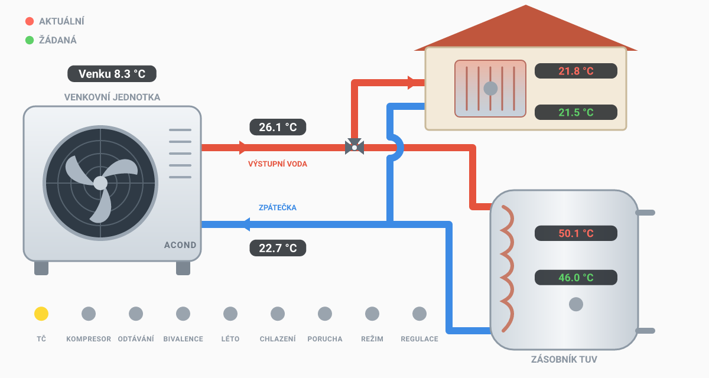
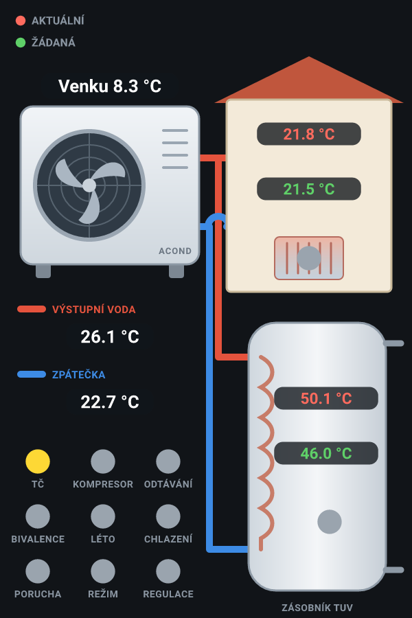

# ♨️ Tepelné čerpadlo Acond pro Home Assistant

Integrace tepelného čerpadla **Acond Therm** do Home Assistantu přes **Modbus TCP**, bez vlastní komponenty, jen jako YAML balíček. K tomu ilustrovaná záložka dashboardu, která ukazuje celý systém (venkovní jednotka, výstupní voda a zpátečka, otopný okruh domu, zásobník TUV) s živými hodnotami a umožňuje ho ovládat.

🌐 **[English README](README.md)**


---

## 📸 Náhled

| Počítač | Telefon |
|---|---|
|  |  |

> Náhledy jsou vykreslené z konfigurace dashboardu s ukázkovými hodnotami. V Home Assistantu jsou ikony skutečné MDI ikony a ventilátor se při běhu kompresoru točí.

---

## ✨ Funkce

- **Modbus TCP** hub se všemi registry, které firmware Acond zpřístupňuje (input `30001–30018`, holding `40001–40012`)
- **Senzory**: okruh 1 a 2 (aktuální / žádaná), TUV (aktuální / žádaná), výstupní voda, zpátečka (aktuální / žádaná), venkovní teplota, solanka, heartbeat komunikace
- **Stavové bity** z `TC_status` jako binární senzory: TČ zapnuto, kompresor, porucha, ohřev TUV, oběh okruhu 1, odtávání, bivalence, letní provoz, chlazení
- **Ovládání**:
  - termostaty (`climate`) pro okruh 1 a TUV, žádaná teplota se zapisuje do holding registrů
  - `select` pro režim TČ (Automat / Jen TČ / Jen bivalence / Vypnuto / Chlazení), zachovává ostatní bity `TC_set`
  - `select` pro typ regulace (AcondTherm / Ekviterm / Manuál)
  - `number` pro žádanou zpátečku v manuálním režimu
- **Záložka dashboardu**:
  - ilustrované schéma s živými hodnotami: červená = aktuální, zelená = žádaná
  - samostatné rozložení pro počítač a telefon (přepíná se na 768 px)
  - animace ventilátoru při běhu kompresoru, výrazné upozornění na poruchu
  - klepnutím na teplotu se otevře termostat, klepnutím na ikonu režimu/regulace jejich změna
  - grafy teplot a provozu za 24 h

---

## 📦 Obsah

```
packages/acond.yaml               # Modbus hub, senzory, termostaty, template binární senzory / select / number
www/acond/heatpump.svg            # schéma pro počítač
www/acond/heatpump-mobile.svg     # schéma pro telefon (na výšku)
www/acond/fan-spin.svg            # animovaný ventilátor (běží kompresor)
dashboard/heat-pump-view.yaml     # záložka Lovelace (sections) využívající soubory výše
docs/                             # náhledové obrázky
```

---

## 🚀 Instalace

### 1. Zapni Modbus TCP v TČ
Modbus TCP musí být zapnutý v regulaci Acond. Ověř, že je port z Home Assistantu dostupný:

```bash
timeout 3 bash -c '</dev/tcp/192.168.1.100/502' && echo open
```

> ⚠️ TČ dovoluje **jen jednoho Modbus mastera**. Ujisti se, že ho nečte žádný jiný systém. Při výpadku komunikace delším než ~30 s se TČ vrací na vlastní regulaci.

### 2. Zapni packages
V `configuration.yaml` (pokud už blok `homeassistant:` máš, doplň jen `packages:`):

```yaml
homeassistant:
  packages: !include_dir_named packages
```

### 3. Zkopíruj soubory

| Z tohoto repa | Do konfigurace HA |
|---|---|
| `packages/acond.yaml` | `/config/packages/acond.yaml` |
| `www/acond/*.svg` | `/config/www/acond/` |

V `packages/acond.yaml` uprav `host:` na IP adresu svého TČ (výchozí Modbus ID `1`, port `502`).

### 4. Kontrola a restart
**Nastavení → Systém → Opravy → ⋮ → Zkontrolovat konfiguraci** (nebo `ha core check`), pak restartuj Home Assistant.

### 5. Přidej záložku dashboardu
Otevři dashboard → **⋮ → Upravit dashboard → ⋮ → Editor surové konfigurace** a vlož obsah `dashboard/heat-pump-view.yaml` jako novou položku pod `views:`.

---

## 🔢 Mapa registrů

Adresy v Home Assistantu jsou **od nuly** (`30001` → input `0`, `40001` → holding `0`). Teploty jsou `int16 × 10`, big endian.

| Registr | Adresa v HA | Význam | Entita |
|---|---|---|---|
| 30001 | input 0 | Okruh 1 žádaná | `sensor.acond_okruh_1_zadana` |
| 30002 | input 1 | Okruh 1 aktuální | `sensor.acond_okruh_1_aktualni` |
| 30003 | input 2 | Okruh 2 žádaná | `sensor.acond_okruh_2_zadana` |
| 30004 | input 3 | Okruh 2 aktuální | `sensor.acond_okruh_2_aktualni` |
| 30005 | input 4 | TUV žádaná | `sensor.acond_tuv_zadana` |
| 30006 | input 5 | TUV aktuální | `sensor.acond_tuv_aktualni` |
| 30007 | input 6 | `TC_status` bitové pole | `sensor.acond_tc_status` → binární senzory |
| 30008 | input 7 | Zpátečka žádaná | `sensor.acond_zpatecka_zadana` |
| 30009 | input 8 | Zpátečka aktuální | `sensor.acond_zpatecka_aktualni` |
| 30010 | input 9 | Venkovní teplota | `sensor.acond_venkovni_teplota` |
| 30014 | input 13 | Režim (0 automat, 1 TČ, 3 bivalence, 4 vyp, 5 manuál, 6 chlazení) | `sensor.acond_rezim` |
| 30015 | input 14 | Regulace (0 AcondTherm, 1 ekviterm, 2 manuál) | `sensor.acond_typ_regulace` |
| 30016 | input 15 | Solanka (země/voda) | `sensor.acond_solanka` |
| 30017 | input 16 | Čítač komunikace 0–255 | `sensor.acond_heartbeat` |
| 30018 | input 17 | Výstupní voda | `sensor.acond_vystupni_voda` |
| 40001 | holding 0 | Okruh 1 žádaná (zápis) | `climate.acond_okruh_1` |
| 40005 | holding 4 | TUV žádaná (zápis) | `climate.acond_tuv` |
| 40006 | holding 5 | `TC_set` bity režimu (zápis) | `select.acond_rezim_tc`, `sensor.acond_tc_set_raw` |
| 40007 | holding 6 | Typ regulace (zápis) | `select.acond_typ_regulace` |
| 40008 | holding 7 | Žádaná zpátečka – manuál (zápis) | `number.acond_zpatecka_manual` |

Bity `TC_status`: `0` zapnuto · `1` kompresor · `2` porucha · `3` TUV · `4` oběh 1 · `8` odtávání · `9` bivalence · `10` léto · `12` chlazení.

---

## ⚠️ Poznámky

- Entity ID vznikají z českých názvů v balíčku (např. `sensor.acond_tuv_aktualni`). Odkazují na ně šablony i dashboard, takže při přejmenování uprav obojí.
- Zápisy (`climate`, `select`, `number`) jdou přímo do TČ. Začni malými změnami.
- Po změně SVG zvyš v dashboardu `?v=`, jinak prohlížeč použije starou verzi z cache (`/local/` se cachuje 31 dní).
- Okruh 2 a solanka ukazují `0` na instalacích, které je nemají. Pokud je nepotřebuješ, odeber je z balíčku.

---

## 📄 Licence

[MIT](LICENSE)
