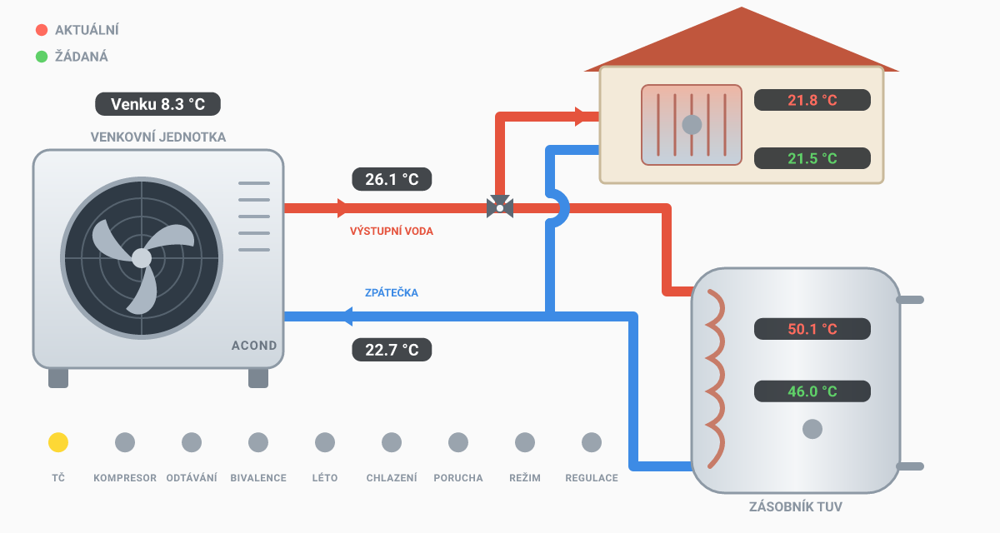
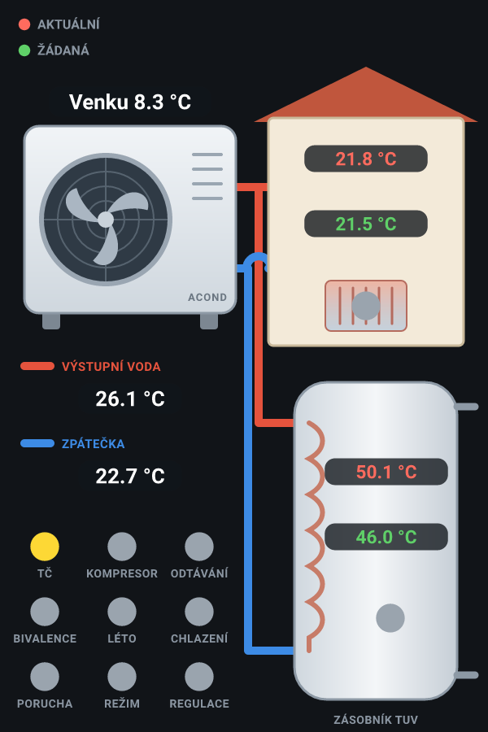

# ♨️ Acond Heat Pump for Home Assistant

Home Assistant integration for **Acond Therm** heat pumps over **Modbus TCP** — no custom component, just a YAML package — plus an illustrated Lovelace dashboard that shows the whole system (outdoor unit, flow/return pipes, house heating circuit, DHW tank) with live values and lets you control it.

🌐 **[Česká verze README](README.cs.md)**


---

## 📸 Preview

| Desktop | Phone |
|---|---|
|  |  |

> Previews are rendered from the dashboard config with sample values; in Home Assistant the icons are real MDI icons and the fan spins while the compressor runs.

---

## ✨ Features

- **Modbus TCP** hub with all registers the Acond firmware exposes (input `30001–30018`, holding `40001–40012`)
- **Sensors**: circuit 1 & 2 (actual / target), DHW (actual / target), flow water, return water (actual / target), outdoor air, brine, communication heartbeat
- **Status bits** from `TC_status` decoded into binary sensors: running, compressor, fault, DHW heating, circulation, defrost, backup heater (bivalence), summer mode, cooling
- **Control**:
  - `climate` thermostats for circuit 1 and DHW (target temperature written to holding registers)
  - `select` for heat pump mode (Auto / Heat pump only / Backup only / Off / Cooling) — preserves the other bits of `TC_set`
  - `select` for regulation type (AcondTherm / Equithermal / Manual)
  - `number` for manual return-water target
- **Dashboard view**:
  - illustrated schematic with live values: red = actual, green = target
  - separate layouts for desktop and phone (switches at 768 px)
  - spinning fan animation while the compressor runs, fault banner
  - tap a temperature to open its thermostat, tap mode/regulation icons to change them
  - 24 h history graphs of temperatures and operation

---

## 📦 Contents

```
packages/acond.yaml               # Modbus hub, sensors, climates, template binary sensors / selects / number
www/acond/heatpump.svg            # desktop schematic
www/acond/heatpump-mobile.svg     # phone schematic (portrait)
www/acond/fan-spin.svg            # animated fan overlay (compressor running)
dashboard/heat-pump-view.yaml     # Lovelace view (sections) using the files above
docs/                             # preview images
```

---

## 🚀 Installation

### 1. Enable Modbus TCP on the heat pump
Modbus TCP must be enabled in the Acond regulation. Check that the port is reachable from Home Assistant:

```bash
timeout 3 bash -c '</dev/tcp/192.168.1.100/502' && echo open
```

> ⚠️ The heat pump accepts **only one Modbus master**. Make sure no other system polls it. If communication stops for more than ~30 s, the heat pump falls back to its own regulation.

### 2. Enable packages
In `configuration.yaml` (merge into an existing `homeassistant:` block if you have one):

```yaml
homeassistant:
  packages: !include_dir_named packages
```

### 3. Copy the files

| From this repo | To your HA config |
|---|---|
| `packages/acond.yaml` | `/config/packages/acond.yaml` |
| `www/acond/*.svg` | `/config/www/acond/` |

Edit `host:` in `packages/acond.yaml` to the IP address of your heat pump (default Modbus ID `1`, port `502`).

### 4. Check and restart
**Settings → System → Repairs → ⋮ → Check configuration** (or `ha core check`), then restart Home Assistant.

### 5. Add the dashboard view
Open your dashboard → **⋮ → Edit dashboard → ⋮ → Raw configuration editor** and paste the contents of `dashboard/heat-pump-view.yaml` as a new item under `views:`.

---

## 🔢 Register map

Addresses in Home Assistant are **0-based** (`30001` → input `0`, `40001` → holding `0`). Temperatures are `int16 × 10`, big endian.

| Register | HA address | Meaning | Entity |
|---|---|---|---|
| 30001 | input 0 | Circuit 1 target | `sensor.acond_okruh_1_zadana` |
| 30002 | input 1 | Circuit 1 actual | `sensor.acond_okruh_1_aktualni` |
| 30003 | input 2 | Circuit 2 target | `sensor.acond_okruh_2_zadana` |
| 30004 | input 3 | Circuit 2 actual | `sensor.acond_okruh_2_aktualni` |
| 30005 | input 4 | DHW target | `sensor.acond_tuv_zadana` |
| 30006 | input 5 | DHW actual | `sensor.acond_tuv_aktualni` |
| 30007 | input 6 | `TC_status` bit field | `sensor.acond_tc_status` → binary sensors |
| 30008 | input 7 | Return water target | `sensor.acond_zpatecka_zadana` |
| 30009 | input 8 | Return water actual | `sensor.acond_zpatecka_aktualni` |
| 30010 | input 9 | Outdoor air | `sensor.acond_venkovni_teplota` |
| 30014 | input 13 | Mode (0 auto, 1 HP, 3 backup, 4 off, 5 manual, 6 cooling) | `sensor.acond_rezim` |
| 30015 | input 14 | Regulation (0 AcondTherm, 1 equithermal, 2 manual) | `sensor.acond_typ_regulace` |
| 30016 | input 15 | Brine (ground/water units) | `sensor.acond_solanka` |
| 30017 | input 16 | Heartbeat counter 0–255 | `sensor.acond_heartbeat` |
| 30018 | input 17 | Flow (outlet) water | `sensor.acond_vystupni_voda` |
| 40001 | holding 0 | Circuit 1 target (write) | `climate.acond_okruh_1` |
| 40005 | holding 4 | DHW target (write) | `climate.acond_tuv` |
| 40006 | holding 5 | `TC_set` mode bits (write) | `select.acond_rezim_tc`, `sensor.acond_tc_set_raw` |
| 40007 | holding 6 | Regulation type (write) | `select.acond_typ_regulace` |
| 40008 | holding 7 | Manual return target (write) | `number.acond_zpatecka_manual` |

`TC_status` bits: `0` on · `1` compressor · `2` fault · `3` DHW · `4` circulation 1 · `8` defrost · `9` backup heater · `10` summer · `12` cooling.

---

## ⚠️ Notes

- Entity IDs are generated from the Czech names in the package (e.g. `sensor.acond_tuv_aktualni`). Templates and the dashboard refer to them — if you rename the entities, update both.
- Writes (`climate`, `select`, `number`) go straight to the heat pump. Test with small changes first.
- After changing an SVG, bump the `?v=` query in the dashboard so browsers don't serve the cached copy (`/local/` is cached for 31 days).
- Circuit 2 and brine read `0` on installations without them — remove those sensors from the package if you don't need them.

---

## 📄 License

[MIT](LICENSE)
